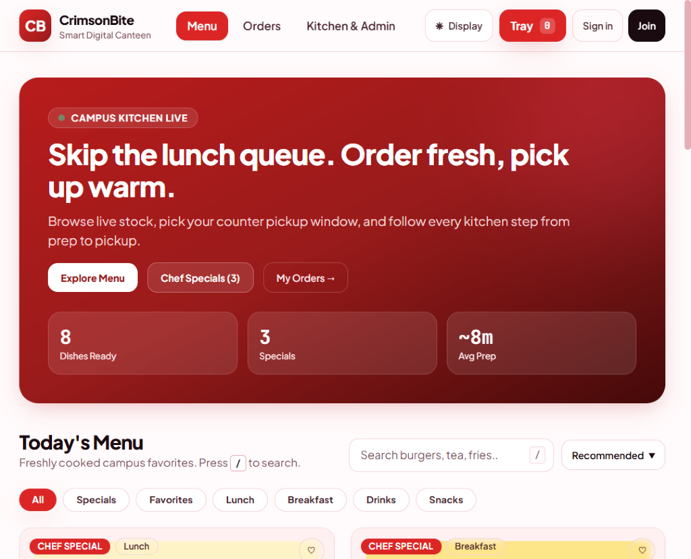

# CrimsonBite — Smart Digital Canteen (`Canteen-project`)

A redesigned **Crimson Red**, HCI-focused **Smart Digital Canteen** ordering and kitchen operations platform built with the **MERN** stack (`MongoDB`, `Express`, `React`, `Node.js`) inside [`SmartDigitalCanteen_MVP/`](SmartDigitalCanteen_MVP/).

---

## Live Demo & Screenshot

- **Live App:** [crimsonbite-smart-canteen.onrender.com](https://crimsonbite-smart-canteen.onrender.com)

<p align="center">
  
</p>

---

## Key Capabilities & UX Improvements

- **Crimson Red Theme & Comfort Controls (`/`):**
  - Supports **Warm Daylight** and **Crimson Dark** modes, **Text Size scaling** (`Standard`, `Large`, `Extra`), **Reduce Motion** preference, and keyboard focus navigation (`/` shortcut jumps straight to menu search).
  - Non-blocking `aria-live` toast notifications replace all native browser `alert` / `confirm` / `prompt` dialogs.
- **Digital Menu, Stock & Tray Ergonomics (`/`):**
  - Category & Favorites tabs, Chef Specials highlighting, sorting by price or prep time, inline `+ / -` quantity steppers, pickup window selector (`ASAP`, `In 15 mins`, `In 30 mins`, `Lunch Break`), and kitchen notes.
- **Live Order Tracking & Order History (`/history`, `/order-history`):**
  - 4-stage live kitchen progress tracker (`Pending` -> `Preparing` -> `Ready` -> `Collected`) with polling, inline two-step cancellation (restores kitchen stock), one-click **Reorder**, and database-backed **Star Ratings & Feedback** (`POST /api/feedback`).
- **Kitchen & Admin Console (`/admin`):**
  - Server-verified passkey unlock (`POST /api/admin/verify`), live kitchen queue advancement, menu CRUD with availability/special toggles and inline delete confirmation, customer feedback view, daily & date-range sales reports, and CSV export.

---

## Tech Stack

- **Frontend (`SmartDigitalCanteen_MVP/frontend/`):** React 18, Vite 5, React Router v6, Tailwind CSS, Framer Motion, Axios
- **Backend (`SmartDigitalCanteen_MVP/backend/`):** Node.js, Express, MongoDB (`Mongoose`), JWT (`jsonwebtoken`), `bcryptjs`, CORS, Morgan

---

## Running Locally

```bash
cd SmartDigitalCanteen_MVP
```

### 1. Backend
```bash
cd backend
npm install
npm run seed          # populate sample menu items (auto-seeds on empty DB too)
npm run dev           # starts API server (http://localhost:5000)
```

### 2. Frontend
```bash
cd frontend
npm install
npm run dev           # starts Vite dev server (http://localhost:5173)
```

### Production Build & Single-Service Deploy (Render)
The root [`render.yaml`](render.yaml) builds `frontend/dist` and serves both `/api/*` endpoints and the React SPA from `SmartDigitalCanteen_MVP/backend/server.js`. Set `MONGO_URI`, `ADMIN_PASSWORD`, and `JWT_SECRET` in Render environment variables.
